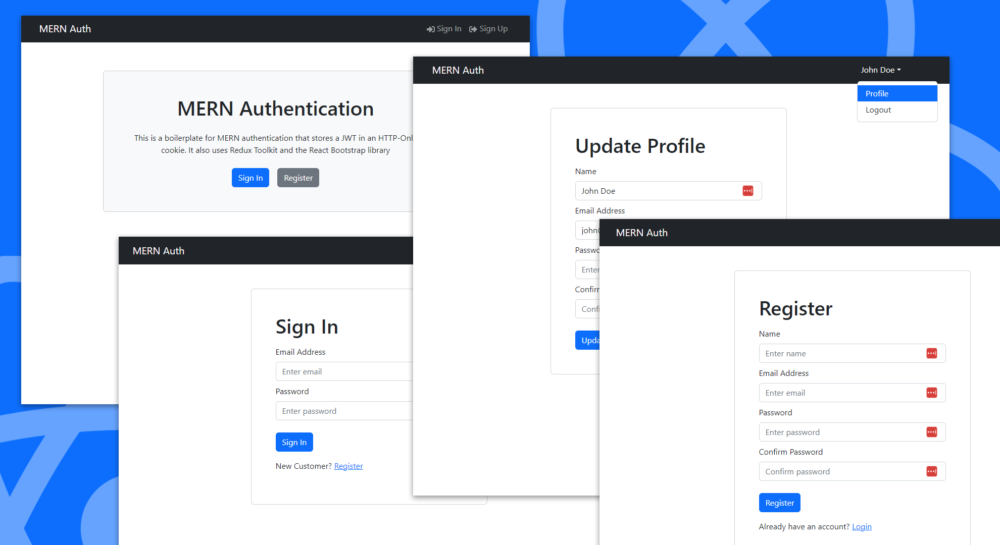

# 🔐 Authify – Secure MERN Authentication & User Management System

A full-stack authentication and user management application built with the **MERN Stack**, featuring secure JWT-based authentication, HTTP-only cookies, protected routes, and centralized state management.

Authify provides a complete authentication workflow, allowing users to register, log in, securely manage their profiles, and log out through a responsive Single Page Application (SPA).

---

## ✨ Key Features

- **User Authentication:** Secure registration, login, and logout workflows.
- **JWT Authentication:** Token-based authentication using HTTP-only cookies.
- **Password Security:** Password hashing using bcrypt with salt rounds.
- **Protected Routes:** Middleware-based backend route protection and frontend private routing.
- **User Profile Management:** Retrieve and update authenticated user profiles.
- **State Management:** Redux Toolkit for centralized authentication state.
- **API Integration:** RTK Query for efficient API requests and mutations.
- **Error Handling:** Centralized error handling with custom Express middleware.
- **Responsive UI:** Modern interface built with React Bootstrap and Bootstrap 5.
- **Production Configuration:** Vite frontend build served through the Express backend.

## 🛠️ Tech Stack

| Category | Technologies |
|---|---|
| Frontend | React 18, Vite |
| Backend | Node.js, Express.js 5 |
| Database | MongoDB, Mongoose |
| State Management | Redux Toolkit, React Redux |
| API Management | RTK Query |
| Authentication | JWT, bcryptjs |
| Security | HTTP-only Cookies |
| Routing | React Router DOM |
| UI | React Bootstrap, Bootstrap 5 |
| Notifications | React Toastify |
| Configuration | dotenv |

## 🏗️ Architecture

Authify follows a client-server architecture:

```text
             React SPA
                 |
        Redux Toolkit / RTK Query
                 |
           HTTP Requests
                 |
          Express.js API
                 |
       Authentication Middleware
                 |
          User Controllers
                 |
             Mongoose
                 |
             MongoDB
```

## 🔑 Authentication Workflow

### 1. User Registration
- Accepts user registration details.
- Checks email uniqueness.
- Hashes passwords using bcrypt.
- Creates a new user in MongoDB.
- Generates a JWT and stores it in an HTTP-only cookie.

### 2. User Login
- Validates user credentials.
- Compares the submitted password with the stored bcrypt hash.
- Generates a JWT upon successful authentication.
- Sets the authentication cookie.

### 3. Protected Routes
- Extracts the JWT from the request cookie.
- Verifies the token using the configured JWT secret.
- Identifies the authenticated user.
- Attaches the user object to `req.user`.
- Rejects unauthorized requests with HTTP 401.

### 4. Profile Management
- Retrieves authenticated user information.
- Updates user profile information.
- Protects profile operations using authentication middleware.

### 5. User Logout
- Clears the authentication cookie.
- Ends the authenticated session from the client's perspective.

## 🔌 REST API Endpoints

Base URL: `http://localhost:5000/api/users`

| Method | Endpoint | Description | Access |
|---|---|---|---|
| POST | `/` | Register a new user | Public |
| POST | `/auth` | Authenticate user | Public |
| POST | `/logout` | Log out user | Public |
| GET | `/profile` | Retrieve user profile | Private |
| PUT | `/profile` | Update user profile | Private |

## 📂 Project Structure

```text
authify/
│
├── backend/
│   ├── config/
│   │   └── db.js
│   │
│   ├── controllers/
│   │   └── userController.js
│   │
│   ├── middleware/
│   │   ├── authMiddleware.js
│   │   └── errorMiddleware.js
│   │
│   ├── models/
│   │   └── userModel.js
│   │
│   ├── routes/
│   │   └── userRoutes.js
│   │
│   ├── utils/
│   │   └── generateToken.js
│   │
│   ├── server.js
│   └── package.json
│
├── frontend/
│   ├── public/
│   ├── src/
│   │   ├── components/
│   │   ├── screens/
│   │   ├── slices/
│   │   ├── App.jsx
│   │   ├── main.jsx
│   │   └── store.js
│   │
│   ├── index.html
│   ├── vite.config.js
│   └── package.json
│
├── .gitignore
└── README.md
```

## ⚙️ Getting Started

### Prerequisites

Make sure you have the following installed:

- Node.js
- npm
- MongoDB or a MongoDB Atlas account
- Git

### 1. Clone the Repository

```bash
git clone https://github.com/AhmedFarag22/authify-mern-user-management.git

cd authify-mern-user-management
```

### 2. Install Backend Dependencies

```bash
npm install
```

### 3. Configure Environment Variables

Create a `.env` file inside the `backend` directory:

```env
NODE_ENV=development
PORT=5000
MONGO_URI=your_mongodb_connection_string
JWT_SECRET=your_secure_random_secret
```

### 4. Install Frontend Dependencies

```bash
cd frontend
npm install
```

### 5. Run the Application

From the project root, use:

```bash
npm run dev
```

This starts the frontend and backend development environments using the configured root scripts.

For backend-only development:

```bash
npm run server
```

### 6. Build for Production

```bash
cd frontend
npm run build
```

The generated frontend build is served by the Express backend in production mode.

## 🔒 Security Considerations

Authify implements several authentication security practices:

- HTTP-only cookies to prevent direct JavaScript access to the authentication token.
- Secure cookie configuration in production environments.
- SameSite cookie policy.
- bcrypt password hashing.
- JWT signature verification and expiration.
- Protected backend endpoints.
- Password exclusion from authenticated user responses.

**Potential Enhancements:**
- Refresh token rotation.
- Rate limiting for authentication endpoints.
- Stronger request validation and sanitization.
- Dedicated CSRF protection where required by the deployment configuration.

## 📸 Screenshots

Add your application screenshots here:



## 🚀 Future Improvements

- Email verification.
- Password reset functionality.
- Role-based access control (RBAC).
- Refresh token rotation.
- Multi-factor authentication (MFA).
- Automated backend and frontend testing.

## 👨‍💻 Author

**Ahmed Farag**

- GitHub: [@AhmedFarag22](https://github.com/AhmedFarag22)
- LinkedIn: [Ahmed Farag](https://www.linkedin.com/)

---

⭐ If you find this project useful, consider giving it a star!
